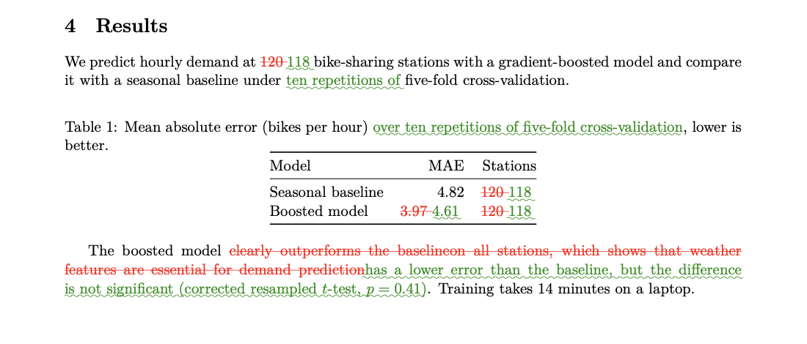

# Research paper skills

You should spend your time on the research, not on hunting for a stale number in Table 3 at midnight before a deadline. 🌱

These skills help your AI agent review your paper like a careful co-author would: they check every number against your results, every claim against your code, every citation against the cited paper, and catch the small issues that are easy to miss. You stay in charge: nothing changes without your approval.

Before anything is changed, you see the proposed fix as a marked-up PDF, with added text in green and removed text in red (a made-up example):



## Skills

| Skill | What it does | Use it when |
|---|---|---|
| [**paper-audit**](skills/paper-audit/) | Audits a LaTeX paper against its results, code, citations and venue rules, with a blind second review and a marked-up PDF of every proposed fix. Works with local folders and Overleaf. | Before submitting, or after the results or the code changed |

## Install

Skills use the `SKILL.md` format. Clone the repository and copy a skill folder into your agent's skills folder, for example for one project:

```bash
git clone https://github.com/JuliaYershova/Research-paper-skills.git
mkdir -p .claude/skills
cp -r Research-paper-skills/skills/paper-audit .claude/skills/
```

Then ask the agent to audit your paper, or call the skill by name (`/paper-audit`).

**Requirements:** git and Python 3.9 or later. Optional: [paper-search-cli](https://github.com/fcakyon/paper-search-cli) for the citation check, and Tectonic or a TeX distribution with latexdiff for compiling and marked-up PDFs. See each skill's README for details.

## How the skills work

- **Sources only.** Every finding points to the paper line and to the line or field in a source. Numbers that are not in the sources never go into the paper.
- **You approve.** Fixes are shown as a marked-up PDF first. Nothing is committed or pushed without an explicit yes.
- **Deterministic where possible.** Scripts list every number, todo and citation, and check quotes, so the results do not depend on what the model happens to notice. The scripts have tests.

## Repository layout

```
skills/
└── paper-audit/
    ├── SKILL.md        the skill
    ├── README.md       how it works, with diagrams and an example
    ├── references/     detailed instructions loaded when needed
    ├── scripts/        deterministic helpers (Python standard library)
    ├── tests/          tests for the scripts
    └── docs/           example of a marked-up change
```

## License

[MIT](LICENSE). Third-party tools used by the skills keep their own licenses (see each skill's README).

## Contributing

This is a young project, and it gets better with every paper it meets. Found a bug, a false alarm, or an issue it missed? Have an idea for a new skill? Please [open an issue](https://github.com/JuliaYershova/Research-paper-skills/issues) or send a pull request. Every contribution is welcome, big or small. Let's make paper writing a little less painful, together. 💛
