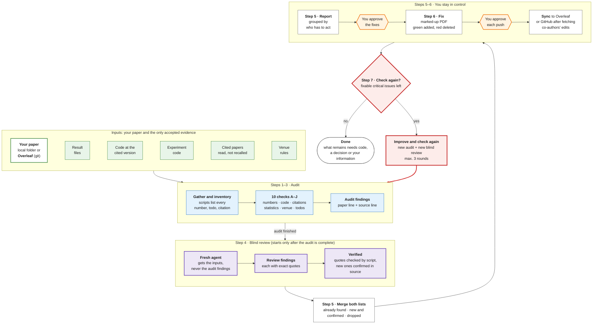
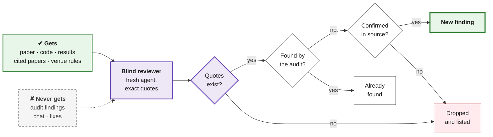
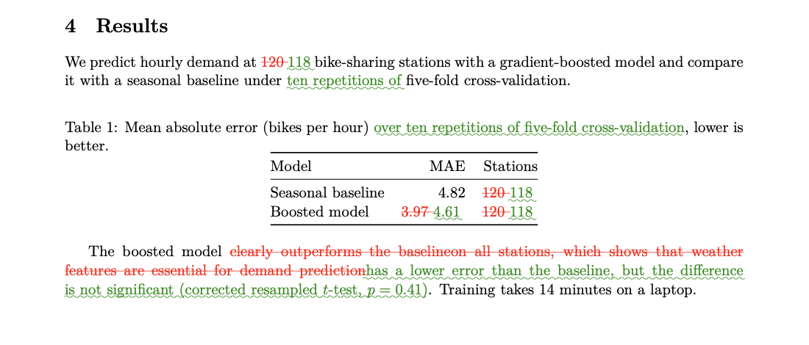

# paper-audit

Audits a LaTeX paper before submission against its results, code, citations and venue rules, and fixes what it can with your approval.

| Goal | How |
|---|---|
| Every number matches its source | Scripts trace each number to the result files |
| Claims match the code | Checked against the code at the cited version and the experiment code |
| Citations are correct and say what you claim | Looked up in Crossref, DataCite and arXiv; the cited paper is read |
| The paper meets the venue's rules | Length, format, required content, software requirements |
| A second, independent opinion | Blind review by an agent that never sees the first findings |
| Changes are safe | Marked-up PDF of every change; you approve each fix and each push |
| Works where you write | Local folder or Overleaf, synced with git |

## How it works



1. **Steps 1–3 · Audit.** Gathers the paper and its sources, lists every number, todo and citation with scripts, and runs ten checks (A–J).
2. **Step 4 · Blind review.** Only when the audit is finished, a second agent reviews the paper from scratch, without seeing the audit's findings.
3. **Step 5 · Merge and report.** Findings the review shares with the audit are marked "already found"; new ones are added only after they are confirmed in the source; the rest are listed as dropped.
4. **Step 6 · Fix.** Nothing is changed, committed or pushed without your approval.
5. **Step 7 · Check again.** If fixable critical issues remain, the whole loop runs again (a new audit and a new blind review), up to three rounds.

## How the blind review works



The reviewer gets the same files as the audit, but none of its results, so it cannot simply agree with them. Every finding has to quote the paper and the source exactly; a script checks that the quotes exist, which removes invented findings. Findings the audit already had are marked as such; new ones go into the report only after they are confirmed in the source. Nothing is dropped silently. For important submissions, the review can run a second time on a different model.

**Example (made up).** The reviewer reports that the text says "118 bike-sharing stations" while `summary.json` has `"n_stations": 120`, quoting both. The script finds both quotes, the audit had not reported it, and the value in `summary.json` confirms it, so it is added as a new finding. A second finding quotes a sentence that is not in the paper; it is dropped and listed as not confirmed.

## What a proposed change looks like

Before anything is applied, the skill builds a marked-up PDF of the change. The example below is a made-up results section ([old](docs/example/old.tex), [new](docs/example/new.tex)): a rerun changed the numbers, and the claim "clearly outperforms" no longer holds once a significance test is added.



latexdiff does not show removed todo notes, so the skill also lists every deletion from the source, here including the removed `\todo` ([full output](docs/example/deleted-text.txt)):

```text
old line 18: DELETED: 3.97
            REPLACED BY: 4.61
old line 23: DELETED: \todo[inline]{Add a significance test.}
old line 24: DELETED: clearly outperforms
            REPLACED BY: has a lower error than
```

## What each step uses

| Step | What happens | Tools |
|---|---|---|
| **1. Gather** | Finds the current paper copy (local or Overleaf), every included file, the code at the version the paper cites, the experiment code, the result files and the venue. Asks when anything is unclear. | git (Overleaf clone, `git archive`), venue guidelines fetched from the venue's own pages |
| **2. Inventory** | Lists every number, todo, citation, label and reference; compares citations with the `.bib`; checks the LaTeX structure; compiles and counts pages without todo boxes. | `tex_inventory.py`, `bib_inventory.py`, `check_source.py`, Tectonic or latexmk |
| **3. Checks A–J** | See the table below. Independent checks can run in parallel agents. | see below |
| **4. Blind review** | A fresh agent reviews the whole paper without seeing the earlier findings. Its quotes are checked automatically; new findings are kept only if the source confirms them. | subagent (optionally a second model), `check_quotes.py` |
| **5. Report** | Findings grouped as text fixes, code changes, decisions and missing information, each with file:line evidence. | — |
| **6. Fix** | Drafts the approved fixes in a local copy, builds a PDF with added text in green and deleted text in red, and lists every deletion. After approval, syncs to Overleaf or GitHub, fetching co-authors' edits first. | latexdiff, Tectonic, `deleted_text.py`, git |
| **7. Check again** | Re-runs the affected checks and the blind review until nothing critical can be fixed from the sources. | — |

## The checks

| Check | Question | Evidence |
|---|---|---|
| **A. Numbers** | Does every number appear in a result file, with the meaning the paper gives it? | `trace_numbers.py` (main result files vs other files) |
| **B. Terms** | Is each concept named the same way throughout? | the paper |
| **C. Software** | Do the claims about the software match the code at the cited version (behaviour, files, tests, CI)? | code, `git ls-tree`, CI runs |
| **D. Evaluation** | Do metric, test, pooling, cost and baseline definitions match the experiment code? | experiment code |
| **E. Citations** | Are entries correct and published versions, and does each cited paper say what the paper claims? | `paper-search` (Crossref, arXiv, OpenAlex), DataCite, publisher pages; the cited paper is read |
| **F. Integrity** | Leakage, aggregation, label alignment, reproducibility from saved outputs | code, outputs |
| **G. Statistics** | Is each comparison backed by a suitable test, and worded accordingly? | result files; optional independent recompute |
| **H. Behaviour claims** | Do statements about what a model does hold in the raw outputs? | raw outputs |
| **I. Venue** | Length, format, anonymity, required content, software requirements | venue guidelines |
| **J. Writing and todos** | Filler, inflated wording, length, and which todos are resolved | the paper |

## Rules that apply throughout

- **Sources only.** Only result files, code, data and cited papers count as evidence. No computed numbers or inferred definitions go into the paper.
- **Ask before acting.** Checkpoints before checking, before fixing and before every push.
- **No AI attribution** in commits or files.
- **Safe git.** Commits name their files, never the whole index; nothing is pushed without an explicit yes.

## Scripts

All scripts use only the Python standard library (3.9+) and are run with `python3 -I`.

| Script | Input | Output |
|---|---|---|
| `tex_inventory.py` | main `.tex` | JSON: numbers (with line, context, bound), todos, citations, labels, references, included files |
| `trace_numbers.py` | inventory, main result files, `--also` other files | JSON: each number as `in_primary`, `only_other`, `not_found`, `bounds` or `small_integers` |
| `bib_inventory.py` | main `.tex`, `.bib` files | cited keys missing from the `.bib`, entries never cited, duplicates, stray text |
| `check_source.py` | main `.tex`, `.bib` files | unbalanced braces and environments, refs without labels, missing citations, table rows with the wrong number of cells |
| `deleted_text.py` | old and new `.tex` | every deleted or replaced passage, with its line |
| `check_quotes.py` | findings JSON | whether each quoted passage exists at the given place |

**Known limitations.** The scripts read LaTeX with patterns, not a full parser.
- Numbers in exponents (`10^{-3}`) are reported as two numbers.
- Numbers produced by macros with arguments are not expanded.
- A match from `trace_numbers.py` is a candidate: the first matching field can be unrelated, so the meaning is always confirmed by hand.

## Requirements

- An AI coding agent that can load skills in the `SKILL.md` format and run shell commands. Steps 3 and 4 work best if it can also start subagents.
- git and Python 3.9 or later.
- Optional:
  - `paper-search` for the citation check (see below);
  - Tectonic or a TeX distribution, plus latexdiff, for compiling and for marked-up PDFs.

## Third-party tools

The citation check (E) uses **paper-search-cli** for Crossref, arXiv, OpenAlex and PubMed lookups and for downloading cited papers. It is a fork of **paper-search-mcp**; both are MIT-licensed.

> Akyon, F. C. (2026). *paper-search-cli: Fast, lightweight CLI for academic paper search, DOI lookup, PDF downloads, and citations* [Computer software]. https://github.com/fcakyon/paper-search-cli
>
> OPENAGS (2025). *paper-search-mcp* [Computer software]. https://github.com/openags/paper-search-mcp

```bibtex
@software{akyon2026papersearchcli,
  author = {Akyon, Fatih Cagatay},
  title  = {paper-search-cli: Fast, lightweight CLI for academic paper search, DOI lookup, PDF downloads, and citations},
  year   = {2026},
  url    = {https://github.com/fcakyon/paper-search-cli},
  note   = {Fork of paper-search-mcp by OPENAGS. MIT License}
}

@software{openags2025papersearchmcp,
  author = {{OPENAGS}},
  title  = {paper-search-mcp},
  year   = {2025},
  url    = {https://github.com/openags/paper-search-mcp},
  note   = {MIT License}
}
```
